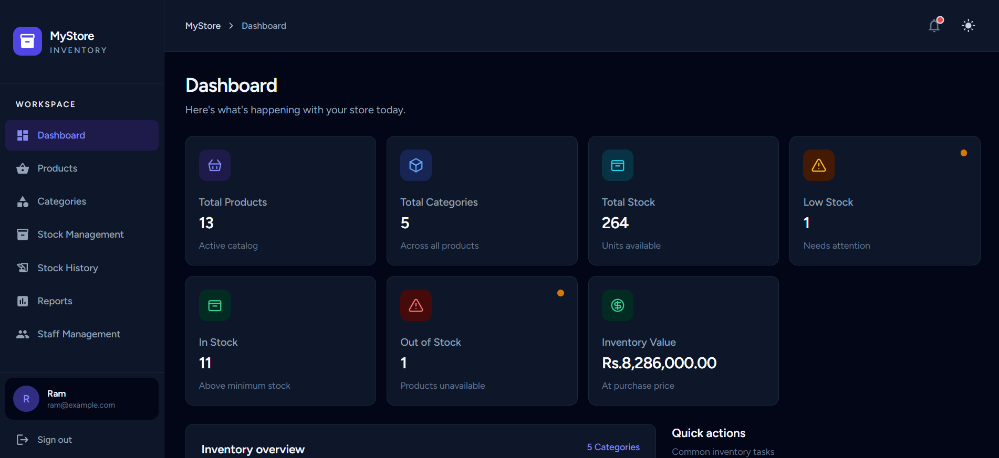
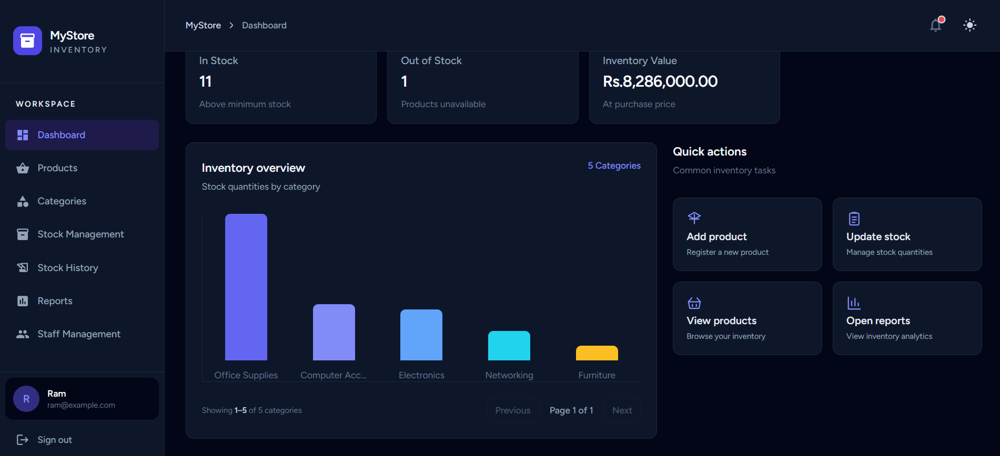
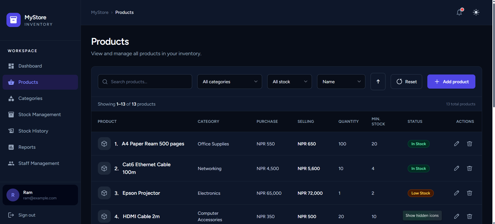
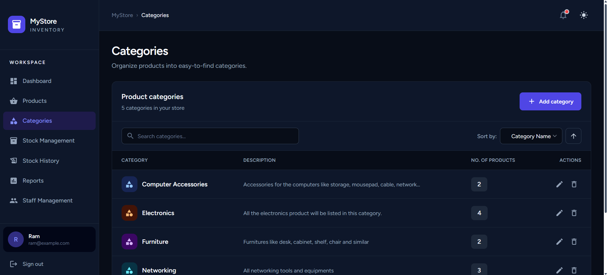
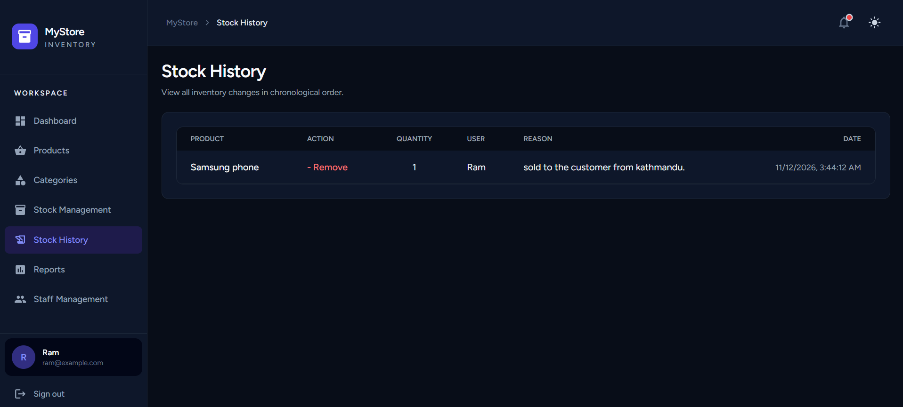
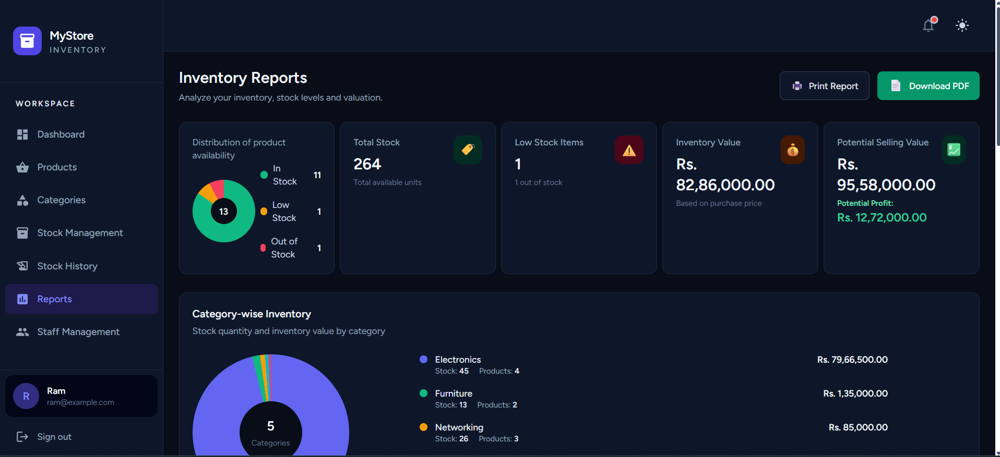
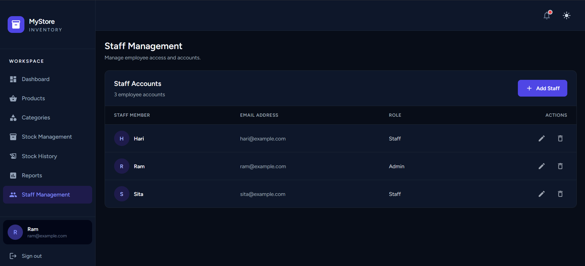
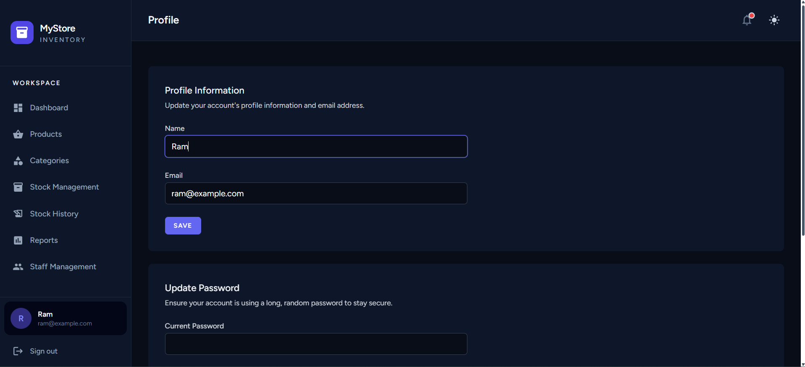
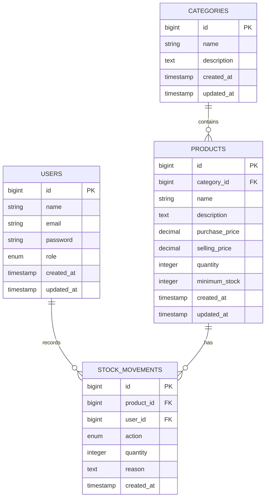

<div align="center">

# Inventory Management System

A modern web-based inventory management system built with **Laravel 12**, **React**, **Inertia.js**, and **Tailwind CSS** for managing products, categories, inventory movements, reports, and staff accounts.

Designed as a Management Information Systems (MIS) academic project with a focus on usability, maintainability, and efficient inventory tracking.

<br>


</div>

---

## Overview

Inventory Management System is a full-stack web application developed using the Laravel ecosystem. It provides a centralized platform for managing products, organizing categories, recording stock movements, generating reports, and administering staff accounts.

The application follows Laravel's MVC architecture with an Inertia.js + React frontend, providing a responsive single-page application experience while maintaining Laravel's server-side routing and authentication.

---

## Features

### Dashboard

- Inventory summary
- Product statistics
- Category statistics
- Recent inventory activity

### Product Management

- Create products
- Update product information
- Delete products
- Product image support
- Search and pagination
- Purchase and selling price management
- Minimum stock tracking

### Category Management

- Create categories
- Update categories
- Delete categories
- Organize products by category

### Stock History

- Record stock movements
- Stock In
- Stock Out
- Movement history
- User activity tracking

### Reports

- Inventory reports
- Stock movement reports
- Summary statistics

### Staff Management

- Create staff accounts
- Update staff information
- Role management
- Secure authentication

### User Profile

- Update profile
- Change password
- Profile management

---

## Screenshots


| Dashboard                                      |
| ---------------------------------------------- |
|  |

| Products                 |
| ------------------------ |
|  |

| Categories               |
| ------------------------ |
|  |

| Stock History            |
| ------------------------ |
|  |

| Reports                  |
| ------------------------ |
|  |

| Staff Management         |
| ------------------------ |
|  |

| User Profile             |
| ------------------------ |
|  |

---

## Technology Stack

| Category        | Technology               |
| --------------- | ------------------------ |
| Backend         | Laravel 12               |
| Language        | PHP 8.2+                 |
| Frontend        | React                    |
| SPA Bridge      | Inertia.js               |
| Styling         | Tailwind CSS v4          |
| Build Tool      | Vite                     |
| Authentication  | Laravel Breeze           |
| Database        | PostgreSQL in production |
| Package Manager | Composer, npm            |

---

## Architecture

The application follows Laravel's MVC architecture with an Inertia.js-powered React frontend.

```
┌────────────────────────────────────────────┐
│                  React UI                  │
└────────────────────────────────────────────┘
                    │
               Inertia.js
                    │
┌────────────────────────────────────────────┐
│          Laravel Controllers               │
└────────────────────────────────────────────┘
                    │
              Eloquent Models
                    │
┌────────────────────────────────────────────┐
│                Database                    │
└────────────────────────────────────────────┘
```

---

## Project Structure

```text
app/
├── Http/
│   ├── Controllers/
│   └── Requests/
├── Models/
├── Policies/
└── Providers/

database/
├── factories/
├── migrations/
└── seeders/

resources/
├── css/
├── js/
│   ├── Components/
│   ├── Layouts/
│   ├── Pages/
│   └── lib/
└── views/

routes/
├── web.php
└── auth.php

public/
storage/
tests/
```

---

## Database Schema

### Entity Relationship Diagram



---

## Database Tables

### Users

| Column   | Description                  |
| -------- | ---------------------------- |
| id       | Primary key                  |
| name     | User name                    |
| email    | Login email                  |
| password | Hashed password              |
| role     | User role (`admin`, `staff`) |

---

### Categories

| Column      | Description          |
| ----------- | -------------------- |
| id          | Primary key          |
| name        | Category name        |
| description | Category description |

---

### Products

| Column         | Description         |
| -------------- | ------------------- |
| id             | Primary key         |
| category_id    | Related category    |
| name           | Product name        |
| description    | Product description |
| purchase_price | Purchase cost       |
| selling_price  | Selling price       |
| quantity       | Current stock       |
| minimum_stock  | Low stock threshold |

---

### Stock Movements

| Column     | Description                |
| ---------- | -------------------------- |
| id         | Primary key                |
| product_id | Related product            |
| user_id    | User performing the action |
| action     | Stock In / Stock Out       |
| quantity   | Quantity changed           |
| reason     | Optional note              |

---

## Installation

### Clone the repository

```bash
git clone https://github.com/Foolmannn/mis-inventory-management-system.git

cd mis-inventory-management-system
```

### Install dependencies

```bash
composer install

npm install
```

### Configure environment

```bash
cp .env.example .env
```

Generate the application key.

```bash
php artisan key:generate
```

Update the database credentials in the `.env` file.

### Run migrations

```bash
php artisan migrate
```

If seeders are available:

```bash
php artisan db:seed
```

### Start the application

Backend

```bash
php artisan serve
```

Frontend

```bash
npm run dev
```

Visit:

```
http://127.0.0.1:8000
```

---

## Authentication

Authentication is provided by Laravel Breeze.

Features include:

- Login
- Logout
- Password hashing
- Session authentication
- Password update
- Profile management

---

## Roles and Permissions

The application implements role-based access control using the `role` field on the `users` table.

| Feature                | Admin | Staff |
| ---------------------- | :---: | :---: |
| Dashboard              |   ✓   |   ✓   |
| Manage Products        |   ✓   |   ✓   |
| Manage Categories      |   ✓   |   ✓   |
| Record Stock Movements |   ✓   |   ✓   |
| View Reports           |   ✓   |   ✗   |
| Manage Staff Accounts  |   ✓   |   ✗   |
| Update Own Profile     |   ✓   |   ✓   |

> **Note:** Permissions are enforced by the application. Administrators have full access, while staff members are restricted from administrative user management.

---

## Development

### Backend

Laravel provides:

- MVC Architecture
- Eloquent ORM
- Form Request Validation
- Authentication
- Authorization
- Database Migrations

### Frontend

The frontend is built using:

- React
- Inertia.js
- Tailwind CSS
- Vite

Together they provide a responsive single-page application while leveraging Laravel's routing, middleware, and backend capabilities.

---

## Running Tests

Run the application's automated test suite.

```bash
php artisan test
```

---

## Code Style

PHP

```bash
./vendor/bin/pint
```

Frontend

```bash
npm run lint
```

> Remove the lint command if the project does not include an ESLint configuration.

---

## Deployment

Build frontend assets.

```bash
npm run build
```

Optimize Laravel for production.

```bash
php artisan optimize
```

Clear caches when necessary.

```bash
php artisan optimize:clear
```

---

## Future Improvements

Possible enhancements for future development include:

- Export reports to PDF
- Export reports to Excel
- Advanced filtering and searching
- Inventory analytics dashboard
- Email notifications
- Low-stock notifications
- Activity log improvements
- Responsive mobile optimizations

These items are suggestions and are **not currently implemented**.

---

## Contributors

This project was developed collaboratively by:

| Name                 | GitHub                               |
| -------------------- | ------------------------------------ |
| **Shishir Adhikari** | https://github.com/ShishirAdhikari12 |
| **Suman Pun Magar**  | https://github.com/Foolmannn         |
| **Suman Giri**       | https://github.com/Sumangiri1312     |

---

## Acknowledgements

This project was developed as part of a university Management Information Systems (MIS) course and demonstrates practical application of modern web development using the Laravel ecosystem.

---

## Repository

```text
Inventory Management System
├── Product Management
├── Category Management
├── Stock Movement Tracking
├── Reports
├── Staff Management
├── Authentication
└── User Profile
```

---

<div align="center">

**Built with Laravel, React, Inertia.js, and Tailwind CSS**

If you found this project useful or informative, consider giving the repository a ⭐.

</div>
